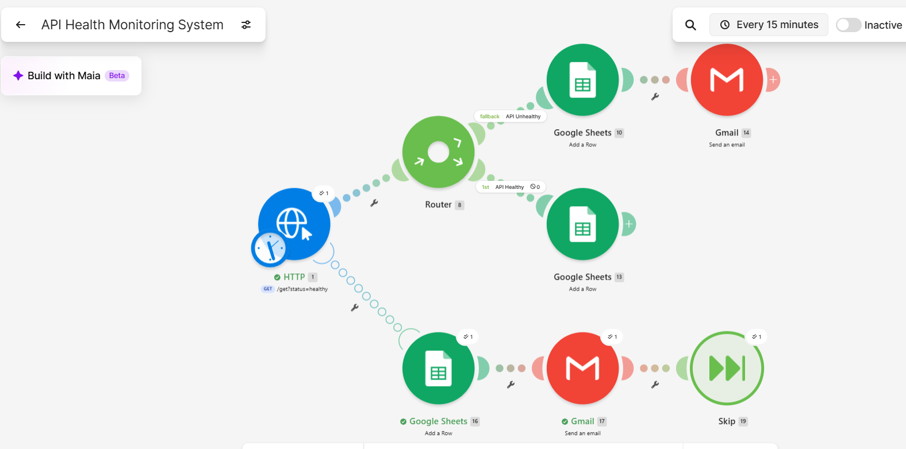
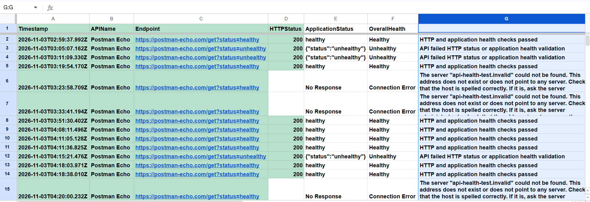
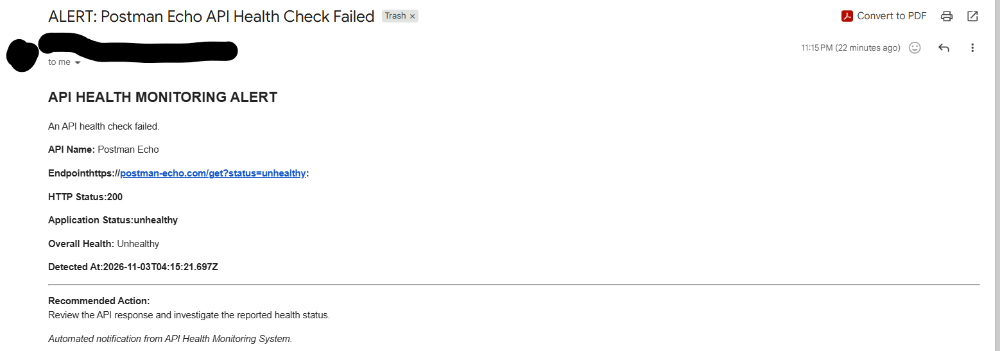
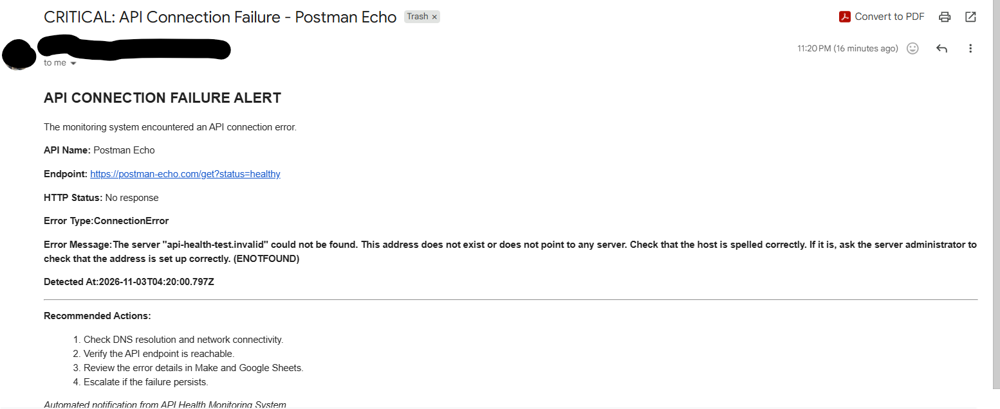

# API Health Monitoring System

An automated API monitoring and failure-notification system built with **Make.com, HTTP, Google Sheets, and Gmail**.

The system periodically checks a configured API endpoint, evaluates both its HTTP response and application-level health status, records monitoring results, and generates email alerts when problems are detected.

## Project Overview

APIs are critical components of modern software integrations. An API can appear operational at the HTTP level while experiencing application-level failures. Connection errors, DNS failures, and timeouts can also disrupt services before an HTTP response is received.

This project demonstrates how to build an automated monitoring workflow that distinguishes between these conditions and handles them appropriately.

### Key Capabilities

- Performs automated HTTP GET health checks.
- Evaluates HTTP status codes and application-level health responses.
- Uses conditional routing to distinguish healthy and unhealthy responses.
- Records monitoring results in Google Sheets.
- Sends automated email alerts for unhealthy responses.
- Captures HTTP execution errors using a dedicated error-handler route.
- Logs connection-failure diagnostics and sends critical alerts.
- Uses error-handling directives to manage failed executions.
- Supports recurring monitoring through configurable scheduling.

## Technology Stack

| Technology | Purpose |
|---|---|
| Make.com | Workflow orchestration, routing, scheduling, and error handling |
| HTTP module | API requests and response inspection |
| Postman Echo | Public endpoint for simulated health checks |
| Google Sheets | Monitoring history and error logs |
| Gmail | Automated failure notifications |

## System Architecture
### Make.com Workflow Architecture

The screenshot below shows the complete monitoring scenario, including healthy-response routing, unhealthy-response logging and alerts, and HTTP connection-error handling.


```text
               Scheduled Execution
                       |
                       v
                 HTTP GET Request
                       |
            +----------+-----------+
            |                      |
       HTTP Response          Execution Error
            |                      |
            v                      v
          Router             Error Handler
         /      \                  |
        /        \                 v
     Healthy   Unhealthy      Google Sheets
        |         |                 |
        v         v                 v
     Google    Google Sheets       Gmail
     Sheets       |                 |
                  v                 v
                 Gmail             Skip
```

The normal router evaluates returned HTTP responses, while the dedicated error-handler route captures failures raised by the HTTP module.

## Health Evaluation Logic

The monitoring system uses two conditions to identify a healthy response:

1. HTTP status code equals `200`.
2. The returned application status equals `healthy`.

Both conditions must be satisfied.

If either condition fails, the response is routed through the unhealthy fallback branch.

### Example: Healthy Response

```json
{
  "status": "healthy"
}
```

When accompanied by HTTP 200, this response is classified as Healthy.

### Example: Unhealthy Response

```json
{
  "status": "unhealthy"
}
```

Even when accompanied by HTTP 200, this response is classified as Unhealthy.

This demonstrates the difference between HTTP request success and application health.

## Monitoring Results and Logging

Google Sheets stores monitoring history using the following fields:

| Field | Description |
|---|---|
| Timestamp | Time the check was executed |
| APIName | Name of the monitored service |
| Endpoint | Configured monitoring endpoint |
| HTTPStatus | HTTP response code, when available |
| ApplicationStatus | Application health value or failure indicator |
| OverallHealth | Healthy, Unhealthy, or Connection Error |
| Details | Validation results or error diagnostics |

The logs distinguish between application health failures and errors where no HTTP response was received.

### Monitoring Log — Test Results

The screenshot below demonstrates how the system records healthy API responses, unhealthy application responses, and connection failures in Google Sheets.



## Automated Email Alerts

The workflow sends email notifications for two categories of failure.

### Application Health Failure

When an HTTP response fails the health validation conditions, the system logs the result and sends an alert containing the API name, endpoint, HTTP status, application status, detection time, and recommended actions.

### Connection Failure

When the HTTP module encounters an execution error, a separate error-handler route captures available diagnostics, records the failure in Google Sheets, and sends a critical email notification.

This path was tested with an invalid DNS hostname and successfully recorded a `ConnectionError` containing an `ENOTFOUND` diagnostic.
### Application Health Failure Alert

The following email was generated when the API returned an application status of `unhealthy` despite an HTTP 200 response.



### Connection Failure Alert

The following email demonstrates the DNS connection-error notification, including the captured error type, diagnostic message, and recommended troubleshooting actions. The endpoint displayed in this prototype alert is a fixed configured value, not necessarily the endpoint used in the failure test.


## Error Handling

The HTTP module uses a dedicated error-handling route:

```text
HTTP Error
    |
    v
Google Sheets — Log Failure
    |
    v
Gmail — Send Alert
    |
    v
Skip — Handle Failed Bundle
```

The Skip directive handles the failed bundle after logging and notification.

The HTTP error handler is scoped to the HTTP module. It does not automatically handle failures in downstream Google Sheets or Gmail modules.

## Functional Testing

The workflow was tested through manual scenario executions in Make.

| Test | Expected Behavior | Result |
|---|---|---|
| HTTP 200 with healthy application status | Log as Healthy | Passed |
| HTTP 200 with unhealthy application status | Log as Unhealthy | Passed |
| Successful health check | Record monitoring history | Passed |
| Unhealthy response | Generate email alert | Passed |
| Invalid DNS hostname | Capture connection error | Passed |
| Connection failure | Record diagnostic error in Google Sheets | Passed |
| Connection failure notification | Generate critical email alert | Passed |
| Normal response following failure tests | Return to healthy monitoring | Passed |
| HTML email formatting | Display structured alert content | Passed |

Testing confirmed correct routing, data mapping, error capture, and email generation.

## Scheduling

The scenario is configured for checks every 15 minutes.

Automatic execution is currently disabled to avoid unnecessary Make credit consumption during portfolio development.

The configured schedule demonstrates recurring monitoring capability, but continuous unattended operation has not been validated.
## How to Reproduce

This project can be recreated in Make.com using the provided workflow blueprint or by manually configuring the modules.

### Prerequisites

- A Make.com account
- A Google account with access to Google Sheets
- A Gmail connection for failure notifications
- Basic familiarity with HTTP requests and JSON responses

### 1. Create the Monitoring Spreadsheet

Create a Google Sheets spreadsheet named `API Health Monitoring Log`.

Add these column headers in row 1:

| Timestamp | APIName | Endpoint | HTTPStatus | ApplicationStatus | OverallHealth | Details |
|---|---|---|---|---|---|---|

### 2. Import the Scenario Blueprint
**Download the workflow:** [Make.com Blueprint](api-health-monitoring.blueprint.json)

This sanitized blueprint contains the scenario's modules, mappings, routing logic, and error-handling configuration. After importing, configure your own Google connections, spreadsheet, and email recipient before running it.
1. Download `api-health-monitoring.blueprint.json` from this repository once the sanitized blueprint has been published.
2. Sign in to Make.com.
3. Create a new scenario.
4. Open the three-dot menu in the scenario builder.
5. Select **Import blueprint**.
6. Choose the downloaded JSON file.
7. Save the imported scenario.

Reconnect the Google Sheets and Gmail modules using your own accounts. Select the monitoring spreadsheet created in Step 1.

Do not activate recurring scheduling until configuration and testing are complete.

### 3. Configure the HTTP Health Check

Set the HTTP module to:

- **Method:** GET
- **URL:** `https://postman-echo.com/get?status=healthy`
- **Timeout:** 10 seconds
- **Parse response:** Enabled
- **Return error if HTTP request fails:** Disabled

### 4. Configure Health Evaluation

The router uses two branches.

**Healthy Route**

Both conditions must be satisfied:

- HTTP Status Code equals `200`.
- `Data → args → status` equals `healthy`.

Matching responses are recorded in Google Sheets with an overall status of `Healthy`.

**Unhealthy Route**

Configure the second route as a fallback.

Responses that do not satisfy the Healthy conditions are recorded as `Unhealthy` and trigger a Gmail alert.

### 5. Configure HTTP Error Handling

Attach an error handler directly to the HTTP module.

The error-handler route uses:

1. Google Sheets — Record connection failure
2. Gmail — Send critical failure alert
3. Skip — Handle the failed bundle

The logged error details should include the HTTP module's error message.

### 6. Run Functional Tests

**Test A — Healthy Response**

Set the HTTP URL to:

`https://postman-echo.com/get?status=healthy`

Run the scenario once.

Expected result: Google Sheets records HTTP `200`, application status `healthy`, and overall health `Healthy`.

**Test B — Application Failure**

Set the HTTP URL to:

`https://postman-echo.com/get?status=unhealthy`

Run the scenario once.

Expected result: The unhealthy fallback executes, Google Sheets records `Unhealthy`, and Gmail sends an application-health alert.

**Test C — Connection Failure**

Set the HTTP URL to:

`https://api-health-test.invalid/health`

Run the scenario once.

Expected result: The HTTP error handler captures the connection failure, Google Sheets records `Connection Error`, and Gmail generates a critical notification.

### 7. Restore the Original Configuration

After testing:

1. Restore `https://postman-echo.com/get?status=healthy`.
2. Save the HTTP module and scenario.
3. Confirm the scenario is configured for 15-minute monitoring intervals.
4. Leave the scenario inactive unless ongoing monitoring is intentionally required.

### Reproduction Notes

- The current prototype uses fixed endpoint text in the connection-error logging and alert paths. Update these values for your environment.
- Gmail notification placement depends on the recipient's mailbox configuration.
- The system requires separate handling for downstream Google Sheets or Gmail failures.
- Imported blueprints may require reconnection and configuration of external services.
- Avoid using real credentials or sensitive operational data during testing.
## Known Limitations

This is a functional portfolio prototype rather than a production monitoring service.

Current limitations include:

- The connection-error logging and email paths use a fixed endpoint value, which can differ from the actual URL used during temporary failure tests.
- Gmail successfully processes and delivers test notifications, but messages have appeared in Trash. The cause of that mailbox behavior has not been resolved.
- Monitoring results for healthy and unhealthy application responses are not normalized consistently in every test record.
- Downstream failures in Google Sheets or Gmail do not have comprehensive recovery handling.
- Alert deduplication, rate limiting, and escalation policies have not been implemented.
- The system has not been subjected to extended unattended monitoring or load testing.
- Timeout handling is supported by the HTTP error-handling design but has not been separately verified through a controlled timeout test.

## Future Enhancements

Potential improvements include:

- Centralized endpoint configuration.
- Accurate requested-URL logging for connection failures.
- Retry policies with exponential backoff.
- Notification deduplication and alert suppression.
- Consecutive-failure thresholds to reduce false alarms.
- Recovery notifications when a previously unhealthy service becomes healthy.
- Response-time measurement and performance trend analysis.
- Monitoring of multiple API endpoints.
- Dashboards for availability and incident history.
- Additional error handling for notification and storage failures.

## Skills Demonstrated

This project demonstrates hands-on experience with:

- HTTP requests and status-code interpretation
- Application-level health validation
- Conditional workflow routing
- Scheduled automation
- API integration
- Data mapping and persistent logging
- Exception handling and failure diagnostics
- DNS and connection-error troubleshooting
- Automated email notifications
- Functional testing and verification
- Technical documentation

## Project Purpose

This project was developed as part of a practical automation engineering learning portfolio.

The objective was to build a functioning monitoring system, deliberately introduce failures, observe how the workflow behaved, and implement appropriate logging and notification mechanisms.

**Project Status:** Functional prototype — core monitoring, routing, logging, connection-error handling, and notification tests completed.
